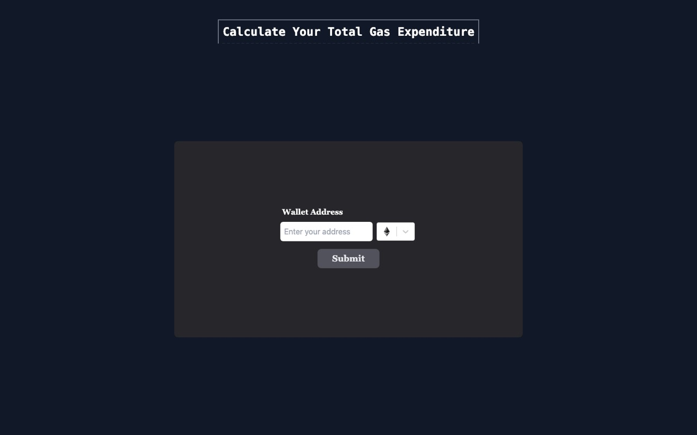

# GasSpent

Find out how much you have spent on gas. Paste a wallet address, pick a chain, and GasSpent totals the gas fees from every transaction that wallet has sent, in ETH and in USD.

**Live demo:** https://gas-spent.vercel.app



## Supported chains

| Chain    | Data source               |
|----------|---------------------------|
| Ethereum | Etherscan API             |
| Base     | Basescan API              |
| Optimism | Optimistic Etherscan API  |
| Arbitrum | Arbiscan API              |
| Linea    | Lineascan API             |

## How it works

1. Fetches the wallet's transaction list from the chain's block explorer API.
2. Requests the receipt for each transaction and multiplies `gasUsed` by `effectiveGasPrice`.
3. Sums the fees, converts them to USD using the current ETH price, and lists each transaction.

Requests are cancelled with an `AbortController` when you change the address or chain.

## Tech stack

React 18 · Vite · Tailwind CSS · react-select · Etherscan-family REST APIs

## Run locally

```bash
cd Total_Gas_Spent
npm install
```

Create `Total_Gas_Spent/.env` with one free API key per explorer:

```
VITE_API_ETHKEY=...
VITE_API_BASEKEY=...
VITE_API_OPKEY=...
VITE_API_ARBKEY=...
VITE_API_LINEAKEY=...
```

Then start the dev server:

```bash
npm run dev
```

## Author

Built by [Akshat Bhriguvanshi](https://akshatttt321.github.io).
